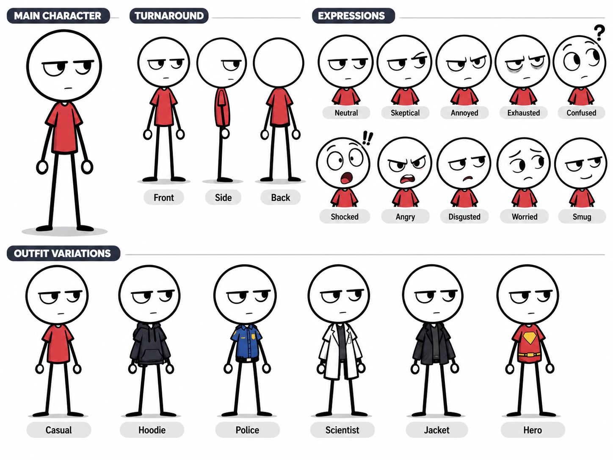

# CURIOUS MIND — MASTER CHARACTER V1.0

Status: draft, menunggu persetujuan pemilik proyek. Belum ada aset final.
Draft visual: [`drafts/stick_figure_master_sheet_draft.png`](drafts/stick_figure_master_sheet_draft.png) · [`drafts/expressions_sheet_draft.png`](drafts/expressions_sheet_draft.png)
Referensi visual utama: [`references/curious_mind_reference_sheet.png`](references/curious_mind_reference_sheet.png)



## Character Identity

Karakter utama adalah stick figure bergaya kartun minimalis dengan kesan dewasa, datar, lelah, skeptis, dan seperti telah mengalami banyak kejadian aneh.

## Head and Face

- Kepala bulat putih.
- Tanpa rambut.
- Mata oval dengan bentuk half-lidded sebagai ekspresi default.
- Alis hitam tegas dan fleksibel.
- Mulut kecil dan minimalis.
- Wajah harus mampu menampilkan ekspresi emosional yang jelas.
- Ekspresi default: deadpan, bukan ceria.

## Body

- Tubuh stickman sederhana.
- Lengan dan kaki berupa garis hitam.
- Tangan sederhana.
- Tidak menggunakan celana.
- Tidak menggunakan sepatu.
- Tidak mengubah proporsi tubuh antar kostum.

## Clothing System

Pakaian hanya dikenakan pada bagian badan atas. Kostum dapat berubah sesuai peran cerita. Tujuh kostum resmi awal:

- Casual red shirt.
- Hoodie.
- Police uniform.
- Scientist coat.
- Jacket.
- Samurai outfit.
- Superhero costume.

Kostum lain yang khusus untuk cerita tertentu boleh ditambahkan sesuai kebutuhan.

Pakaian tidak boleh mengubah bentuk dasar kepala, wajah, lengan, atau kaki.

## Core Expressions

1. Neutral / Deadpan
2. Skeptical
3. Annoyed
4. Exhausted
5. Confused
6. Shocked
7. Angry
8. Disgusted
9. Worried
10. Smug

## Consistency Rules

- Selalu pertahankan bentuk kepala dan proporsi karakter.
- Jangan menambahkan rambut, celana, atau sepatu.
- Jangan menjadikan senyum sebagai ekspresi default.
- Kostum boleh berubah, identitas karakter tidak.
- Jangan mengubah desain master tanpa persetujuan.

## Asset Naming

Gunakan lowercase snake_case, mengikuti aturan `assets/ASSET_REGISTRY.md`: versi pertama **tanpa suffix**. Suffix `_v02`, `_v03`, dan seterusnya hanya untuk revisi berikutnya.

- `stick_figure_master.png`
- `expression_deadpan.png`
- `expression_skeptical.png`
- `outfit_police.png`
- `outfit_hoodie.png`
- Revisi: `expression_deadpan_v02.png`

File di `drafts/` memakai akhiran `_draft` dan bukan aset produksi.

## Folder Structure

```
characters/
└── stick_figure/
    ├── MASTER_CHARACTER.md   # dokumen ini
    ├── expressions/          # expression_<nama>.png
    ├── outfits/              # outfit_<nama>.png
    ├── poses/                # pose aksi (penamaan menyusul)
    ├── references/           # gambar acuan visual, bukan aset produksi
    └── drafts/               # draft visual untuk ditinjau, bukan aset produksi
        └── src/              # generator draft (satu geometri untuk semua view & ekspresi)
```

## Geometri Draft (acuan konsistensi)

Satuan: radius kepala = 100. Semua view dan ekspresi memakai geometri yang sama dari `drafts/src/generate_drafts.py`.

| Bagian | Nilai |
|---|---|
| Tinggi total | ≈ 2,8 diameter kepala (kepala ≈ 36% tinggi) |
| Garis outline, lengan, kaki | 7 |
| Kelopak atas (ciri utama half-lidded) | 11 |
| Alis | 10, terpisah di atas kelopak |
| Mata | oval, posisi tetap; ekspresi hanya mengubah kelopak, pupil, alis, mulut |
| Tangan | bulat putih dengan outline |
| Kaki | garis hitam pendek, tanpa sepatu |

| Warna | Hex |
|---|---|
| Outline / mata / alis | `#1A1A1A` |
| Kepala & tangan | `#FFFFFF` |
| Kaos merah (casual) | `#D64541` |
| Kerah / bayangan kaos | `#A8322F` |
| Dalam mulut | `#7A2323` |

Untuk membuat ulang draft: `python3 characters/stick_figure/drafts/src/generate_drafts.py characters/stick_figure/drafts` (butuh `rsvg-convert`).
